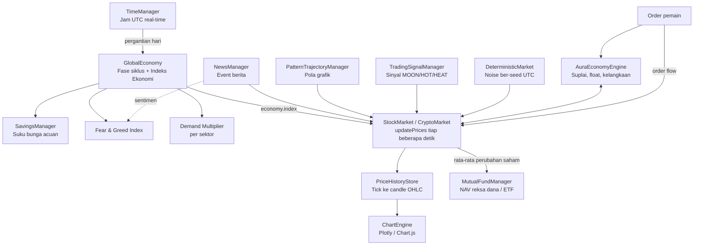
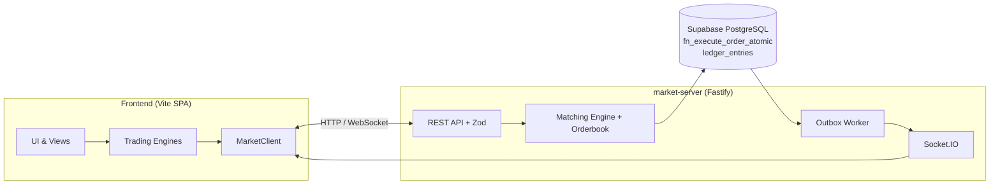

# AuraAssets 💼📈

**AuraAssets** adalah game simulasi **investasi, trading, dan finansial** yang berfokus pada **simulasi pasar makroekonomi**. Harga aset tidak sekadar naik-turun acak. Setiap harga adalah hasil dari beberapa lapisan algoritma yang saling memengaruhi: siklus ekonomi global, suplai terbatas, berita pasar, pola grafik, sinyal trading, dan arus order pemain.

Tujuan game ini adalah membuat pemain **merasakan cara kerja pasar**. Ekonomi berayun antara ekspansi dan resesi, bank sentral menyesuaikan suku bunga, aset langka menjadi mahal saat diborong, dan berita bisa menggerakkan satu sektor. Pemain belajar membaca kondisi itu, mengatur risiko, dan menumbuhkan kekayaan dari modal kecil.

> **Catatan:** Frontend adalah *Single Page Application* (SPA) sisi klien dengan tema gelap bergaya glassmorphism. Frontend ini dilengkapi **Authoritative Multiplayer Market Engine** (`market-server/`) berbasis Fastify, Socket.IO, dan Supabase PostgreSQL untuk transaksi antarpemain yang aman.

---

## 📑 Daftar Isi

1. [Filosofi Desain](#-filosofi-desain)
2. [Cara Kerja Simulasi (Gambaran Besar)](#-cara-kerja-simulasi-gambaran-besar)
3. [Mesin Makroekonomi](#-mesin-makroekonomi)
4. [Pembentukan Harga Aset](#-pembentukan-harga-aset)
5. [Instrumen Investasi](#-instrumen-investasi)
6. [Perbankan & Kekayaan](#-perbankan--manajemen-kekayaan)
7. [Pendapatan Pasif & Bot](#-pendapatan-pasif--bot-trading)
8. [Profil Risiko Pemain](#-profil-risiko-pemain)
9. [Mode Multiplayer](#-mode-multiplayer-market-server)
10. [Tech Stack](#️-tech-stack) · [Memulai](#-memulai) · [Struktur Proyek](#-struktur-proyek) · [Pengujian](#-pengujian)
11. [Fitur Terisolasi](#️-fitur-terisolasi-archived) · [Changelog](#-riwayat-pembaruan--changelog) · [Lisensi](#️-lisensi)

---

## 🧠 Filosofi Desain

| Prinsip | Penjelasan |
|---------|------------|
| **Pasar punya "cuaca"** | Ada fase ekonomi global (Bull, Bear, dan seterusnya) yang berlangsung berminggu-minggu sampai berbulan-bulan. Fase ini menjadi latar bagi semua aset. |
| **Harga = banyak gaya yang bertemu** | Harga bergerak karena acak, tren makro, berita, pola teknikal, kelangkaan, dan order flow sekaligus. Tidak ada satu faktor yang mendominasi. |
| **Aset itu terbatas** | Saham dan kripto punya total suplai dan *free float* yang terbatas. Pemain yang memborong aset membuat aset itu makin langka dan harganya naik. |
| **Pemain bukan Tuhan, tapi punya pengaruh** | Transaksi pemain mengubah harga lewat *price impact* dan *order flow*, tetapi dibatasi agar tidak merusak ekonomi global. |
| **Ramah pemula, tetap menantang** | Ada *safety net* untuk pemain baru, instrumen ultra-aman, dan batas bawah harga. Risiko dan resesi tetap nyata. |
| **Waktu nyata** | Jam game mengikuti **waktu UTC dunia nyata (1×)**. Satu hari game sama dengan satu hari UTC. Semua pemain berbagi "dunia" yang sama. |
| **Konsisten antar perangkat** | Pergerakan harga mikro memakai PRNG ber-*seed* waktu UTC. Semua tab, akun, dan perangkat melihat harga yang sama tanpa server ticker 24/7. |

---

## 🔭 Cara Kerja Simulasi (Gambaran Besar)

Game ini berjalan pada dua skala waktu yang saling terkait:

- **Skala makro (harian):** `TimeManager` mendeteksi pergantian hari UTC lalu memanggil `GlobalEconomy.naturalFluctuation()`. Fungsi ini memperbarui indeks ekonomi, fase siklus, NAV reksa dana, harga komoditas, dan *rollover* harga penutupan.
- **Skala mikro (detik):** Harga saham diperbarui tiap ±6 detik dan kripto tiap ±3–4 detik. Tick-tick ini direkam menjadi candlestick OHLC.



---

## 🌐 Mesin Makroekonomi

### 1. Siklus Bisnis dengan Rantai Markov (`GlobalEconomy`)
Ekonomi memiliki **indeks** (basis 1000, batas bawah 150) dan satu dari **6 fase**:

| Fase | Drift/hari | Volatilitas | Durasi (hari) | Makna |
|------|:---------:|:-----------:|:-------------:|-------|
| 🔵 Recovery | +0,12% | 0,6% | 90–180 | Ekonomi mulai pulih |
| 🟢 Bull | +0,25% | 1,0% | 120–240 | Ekspansi, optimisme |
| 🟠 Correction | −0,06% | 0,7% | 30–60 | Koreksi sehat |
| 🟡 Peak | −0,04% | 0,8% | 60–120 | Puncak, risiko gelembung |
| 🔴 Bear | −0,18% | 1,5% | 90–180 | Resesi |
| ⚪ Trough | +0,06% | 0,4% | 60–120 | Dasar pasar, peluang akumulasi |

**Perpindahan fase bersifat probabilistik** dan memakai *transition matrix*, bukan urutan tetap. Contoh:
- Dari **Bull**, kemungkinan terbesar ke Correction (52%), lalu Peak (30%).
- Dari **Peak**, kemungkinan terbesar ke Bear (55%).
- Dari **Bear**, kemungkinan terbesar ke Trough (45%), lalu Recovery (28%).
- Dari **Trough**, kemungkinan terbesar ke Recovery (60%).

Dengan begitu pola "naik, puncak, jatuh, pulih" cenderung terbentuk, tetapi tidak pernah persis sama dua kali.

**Perubahan indeks harian** dihitung dari empat komponen:

$$\Delta = \underbrace{m_t}_{\text{momentum}} + \underbrace{drift_{fase}}_{\text{tren fase}} + \underbrace{0{,}004 \cdot \frac{1000-I}{1000}}_{\text{mean reversion}} + \underbrace{bonus_{recovery}}_{\text{pemulihan progresif}}$$

- **Momentum:** `m_t = 0,65·m_(t−1) + 0,35·acak(±volatilitas)`. Gerakan hari ini dipengaruhi hari kemarin, jadi tren terasa "mengalir".
- **Mean reversion:** Indeks yang menyimpang jauh dari 1000 ditarik kembali ke tengah, sehingga crash dan bubble tidak berlangsung selamanya.
- **Recovery bonus:** Semakin lama fase Bear atau Trough, semakin kuat dorongan pemulihan berikutnya (maksimum +0,3%/hari).

### 2. Demand Multiplier per Sektor
`getDemandMultiplier(sektor)` menerjemahkan fase ekonomi menjadi permintaan konsumen (rentang aman 0,55–2,20). Multiplier ini dipengaruhi oleh:
- **Fase** (Bull 1,22 · Peak 1,10 · Recovery 1,04 · Correction 0,96 · Bear 0,82 · Trough 0,72).
- **Sensitivitas sektor:** Healthcare (0,30) dan Infrastruktur (0,35) bersifat defensif. Otomotif (1,10) dan Retail (1,00) siklikal. Tech 0,85, Aerospace 0,90, dan F&B 0,75.
- **Posisi indeks** terhadap basis, serta **kebijakan politik** sektoral bila ada.
- **Safety net:** 180 hari game pertama punya batas bawah 0,82 agar pemain baru tidak langsung terkena resesi.

### 3. Fear & Greed Index (5–95)
Skor dihitung dari fase ekonomi (Trough 15 sampai Peak 85), deviasi indeks, dan **berita aktif**. Berita negatif dibobot 1,35× dan berita positif 1,1×, karena rasa takut menyebar lebih cepat daripada keserakahan.

### 4. Suku Bunga Acuan Dinamis (`SavingsManager`)
Suku bunga bank sentral mengikuti fase ekonomi:

| Fase | Suku bunga acuan |
|------|:----------------:|
| Bull | 4,75% |
| Recovery | 5,25% |
| Peak | 5,75% |
| Bear / Correction | 6,50% |

Bunga deposito per tenor (3, 7 hari, dan seterusnya) dihitung dari suku bunga acuan ditambah *spread*, dan ada penalti pencairan dini. Saat pasar jatuh, deposito menjadi lebih menarik sebagai tempat berlindung.

### 5. Berita & Event Pasar (`NewsManager`)
- 40 event (20 saham AS dan 20 kripto) dengan target *ticker*, sektor, atau seluruh pasar (`broad_market`).
- Event dipicu otomatis: jeda minimal 3 menit, maksimal 2 berita aktif, dan peluang acak tiap 15 detik.
- Dampak (`impact_percent`) dibagi rata sepanjang durasi event dan menjadi *bias* harga di setiap tick. Berita bisa mengangkat satu sektor, satu saham, atau seluruh pasar.
- Event dapat disinkronkan dari cloud, sehingga semua pemain melihat berita yang sama.

---

## 💹 Pembentukan Harga Aset

Setiap tick, harga saham dan kripto dihitung dari penjumlahan banyak komponen:

```text
harga_baru = harga × (1 + Brownian + Pola + Berita + Sinyal
                        + Kelangkaan/Resistensi + Makro + Order Flow + Luck)
```

| Komponen | Sumber | Penjelasan |
|----------|--------|------------|
| **Brownian** | `DeterministicMarket` | Noise acak berbasis hash simbol + bucket waktu UTC (FNV-1a + Mulberry32). Hasilnya sama di semua perangkat. Skalanya mengikuti volatilitas aset. |
| **Pola teknikal** | `PatternTrajectoryManager` | Menarik harga mengikuti pola 24 jam (Head & Shoulders, Triangle, Double Top/Bottom, Doji). Doji meredam volatilitas hingga 65%. |
| **Berita** | `NewsManager` | Bias arah dari event yang aktif dan relevan dengan aset. |
| **Sinyal** | `TradingSignalManager` | Sinyal mingguan (MOON, HOT, HEAT, WARM, NEUTRAL, COOL) memberi dorongan bullish kecil dan mengubah volatilitas. |
| **Kelangkaan & resistensi** | `AuraEconomyEngine` | Semakin banyak aset dimiliki pemain, semakin besar dukungan harga. Saat harga naik berlebihan (saham >+80%, kripto >+150%), muncul tekanan *profit-taking*. |
| **Makro** | `GlobalEconomy` | Selisih indeks ekonomi dari 1000 memberi dorongan halus ke seluruh pasar. |
| **Order flow** | Transaksi pemain | Selisih volume beli dan jual membentuk *drift* (maks ±1,2% saham, ±1,8% kripto) yang meluruh 12% per tick. |
| **Luck** | Donasi komunitas | Bonus kecil sementara bila berlaku. |

### Suplai Terbatas & Bonding Curve (`AuraEconomyEngine`)
Mesin ini mengelola **202 aset** (100 saham dan 102 kripto) sebagai ekonomi tertutup:

- **Total supply realistis:** Mega-cap memakai jumlah saham beredar nyata (AAPL 15,5 M lembar). Kripto memakai suplai tokenomics (BTC 21 juta, ETH 120,4 juta, dan seterusnya). Aset lain diestimasi dari tingkat harga.
- **Free float:** 40% untuk saham dan 50% untuk kripto tersedia di *Treasury* AuraAssets.
- **Beli:** Float berkurang, harga naik, dan kas masuk ke reserve. Dampak harga = `(qty / float tersedia) × sensitivitas`, dibatasi maks 20% (saham) atau 35% (kripto) per transaksi. Makin tipis float, makin tajam lonjakannya (*short-squeeze*).
- **Jual:** Float bertambah dan harga turun, dibatasi maks 18% (saham) atau 30% (kripto). Ada *circuit breaker* yang menahan harga agar tidak jatuh di bawah **10% harga dasar**.
- **Metrik makro:** Market cap global, cadangan kas bursa, volume 24 jam, uang beredar, dan papan peringkat aset yang paling banyak dikuasai pemain.
- **Mint token:** Launchpad/Launchpool menambah suplai kripto secara dinamis.

### Grafik Candlestick yang Jujur (`PriceHistoryStore`)
- Setiap tick harga direkam, lalu diagregasi menjadi candle OHLC pada timeframe **1h, 1d, 1w, dan 1m**.
- Data historis awal dibangun dengan *backfill* realistis yang konsisten dengan harga saat ini.
- Candle dapat diambil dari server multiplayer (`market_candles`) agar seragam antarpemain.

### Sinyal Trading Mingguan (`TradingSignalManager`)
Tiap 7 hari game, setiap aset diberi "suhu": **MOON 🚀 → HOT 🔥 → HEAT ⚡ → WARM ☀️ → NEUTRAL 😐 → COOL ❄️**. Peluang MOON hanya sekitar 2–4% dan hanya untuk kripto atau saham volatil. Sinyal berisi estimasi potensi, horizon waktu, dan tingkat risiko. Sinyal ini benar-benar memengaruhi harga, jadi bukan sekadar hiasan.

---

## 📊 Instrumen Investasi

### 📈 Saham (100 emiten, 10 sektor)
Order market dan limit, *take-profit* dan *stop-loss*, dan order book. Harga penutupan di-*roll over* setiap hari sebagai acuan perubahan 24 jam.

### 🪙 Kripto (102 aset, 10 bidang)
L1, DeFi, AI & Big Data, Meme, Stablecoin, DePIN, dan lainnya. Volatilitas lebih tinggi, tick lebih cepat, dampak harga lebih besar, dan ada filter serta sub-kategori.

### 🧺 Reksa Dana & ETF (`MutualFundManager`)
NAV diperbarui harian. Setiap produk punya karakter berbeda terhadap pasar saham:

| Produk | Karakter |
|--------|----------|
| Pasar Uang | Hanya naik, tidak pernah negatif. Cocok untuk pemula |
| Pendapatan Tetap | Imbal hasil stabil, volatilitas rendah |
| Campuran | ~45% mengikuti pasar saham + yield tetap |
| Saham | ~85% mengikuti rata-rata saham |
| ETF `SPY` | Beta 1,0 |
| ETF `QQQ` | Beta 1,35 |
| ETF `SMH` | Beta 1,7 (semikonduktor, paling agresif) |
| ETF `EEM` | Beta 0,75 |
| ETF `XLV` | Beta 0,35 (healthcare, defensif) |
| ETF `VNQ` | Properti, berbasis yield |

Jadi NAV reksa dana dan ETF **bergantung langsung pada rata-rata perubahan 100 saham**. Saat pasar saham jatuh, reksa dana saham ikut jatuh, dan Pasar Uang tetap aman. Ada juga simulator proyeksi return 1 bulan dan 1 tahun.

### 🛢️ Komoditas (Brankas Fisik Digital)
12 komoditas di 4 sektor: Logam Mulia, Energi, Logam Industri, dan Agrikultur. Pergerakan harian memiliki karakter volatilitas per sektor: logam mulia paling tenang, energi paling liar. Aset disimpan 1:1 di vault digital tanpa biaya penyimpanan, bisa dibeli pecahan, dan dilikuidasi instan.

---

## 🏦 Perbankan & Manajemen Kekayaan

- **Pinjaman (`BankSystem`):** 4 produk dengan bunga dan tenor berbeda, yaitu Flash (1,5%, 3 hari), Personal (2,5%, 7 hari), Modal Usaha (4%, 14 hari), dan Kredit Investasi (6%, 30 hari). Plafon bergantung pada **skor kredit**. Cicilan dipotong otomatis harian, pelunasan awal mendapat diskon bunga, dan skor kredit naik atau turun sesuai kedisiplinan bayar.
- **Deposito & Tabungan:** Bunga mengikuti suku bunga acuan yang dipengaruhi fase ekonomi (lihat di atas). Ada bunga bulanan dan setoran otomatis.
- **Transfer P2P (`TransferManager`):** Kirim dana antarpemain dengan biaya admin $1 per $100. Ada **Kotak Donasi Komunitas** yang tersinkron realtime lewat Supabase.
- **Bukti Transfer PNG:** Struk digital minimalis (No. Referensi unik, waktu, pengirim, penerima, nominal, biaya, status, catatan). Struk dapat diunduh dalam resolusi tinggi (1080×1480 px) dan dibuka ulang dari notifikasi.
- **Perpajakan:** Laporan pajak bulanan dan deklarasi pendapatan atau aset.
- **Milestone Finansial:** Pencapaian bertingkat dengan hadiah tunai 75% dari nilai target.
- **Net worth terkonsolidasi:** Kas, saham, kripto, reksa dana, komoditas, deposito, dan staking, dikurangi pinjaman.

---

## 💤 Pendapatan Pasif & Bot Trading

`PassiveIncomeManager` menyediakan cara menumbuhkan aset tanpa trading aktif:

- **Staking kripto:** 18 pool dengan APY berbeda (ETH 4,8%, SOL 7,2%, DOT 11,5%, HYPE 14,5%, DEXE 18%, dan seterusnya). Pool lain mengikuti APY default per sektor. Tersedia mode *flexible* dan *locked*, serta klaim reward.
- **Launchpad / Launchpool / Launchdrop:** Event alokasi token baru dengan fase dan timer. Hasilnya menambah suplai token lewat `AuraEconomyEngine.mintLaunchdropTokens`.
- **Bot trading otomatis (strategi momentum):**
  - *Bot Pasar* (modal min $1.000) mendiversifikasi trading di seluruh pasar.
  - *Bot Sektor* (min $2.000) melakukan rotasi momentum dalam satu sektor.
  - *Bot Aset* (min $500) fokus pada satu aset.

---

## 🧭 Profil Risiko Pemain

Kuesioner onboarding (`RoleManager`) menilai perilaku pemain lalu mengklasifikasikannya sebagai **Investor Konservatif** 🛡️, **Pasif** ⚖️, atau **Agresif** 🚀. Profil ini membentuk rekomendasi dan pengalaman awal. Instrumen berlabel risiko (🛡️ Rendah, ⚖️ Moderat, 🚀 Tinggi) membantu pemain mencocokkan aset dengan profilnya. Tersedia juga *Manulife Dana Kas Mandiri* (~5,2% p.a., tidak pernah negatif) sebagai tempat berlindung.

---

## 🖥️ Antarmuka & Pengalaman

- Dasbor gelap glassmorphism dengan mikro-animasi, responsif, dan navigasi mobile serta keyboard.
- Tabel pasar yang dapat diurutkan (Aset, Nama, Sektor, Volatilitas, Harga, 24h %), badge sektor dan risiko, serta **Top Gainers/Losers** dengan filter Semua, Saham, atau Kripto.
- Chart interaktif (Plotly.js, Chart.js, ECharts) dengan overlay volume dan anotasi pola.
- Panel order dengan tombol alokasi cepat (Min, 25%, 50%, 75%, Maks), riwayat trading, dan pencarian aset.
- Glosarium istilah finansial, efek suara, dan halaman pengaturan.

---

## 🌍 Mode Multiplayer (`market-server/`)

Untuk transaksi antarpemain, server menjadi **sumber kebenaran** (*authoritative*) sehingga klien tidak bisa memalsukan saldo.



- **Atomic settlement:** Eksekusi dan pembatalan order berjalan dalam satu transaksi PL/pgSQL (`fn_execute_order_atomic`, `fn_cancel_order_atomic`).
- **Presisi uang:** Nilai disimpan sebagai `BIGINT` dalam satuan minor.
- **Immutable ledger:** Tabel `ledger_entries` dilindungi *trigger* sebagai log audit yang tidak dapat diubah.
- **Transactional Outbox:** Event dikirim lewat worker `FOR UPDATE SKIP LOCKED`, sehingga tidak ada event yang hilang.
- **Keamanan:** JWT Supabase Auth (`jose`), validasi skema Zod, dan RLS Postgres.
- **Fitur lain:** Penyimpanan candle, berita pasar, sinkronisasi cloud langsung, transfer, dan donasi komunitas (lihat `migrations/001`–`009`).

> Tanpa konfigurasi cloud, game tetap berjalan dalam mode lokal. Ekonomi dan harga tetap dihitung di klien, dan state disimpan di `localStorage`.

---

## 🛠️ Tech Stack

**Frontend (`src/`)**
- HTML5 semantik, CSS3 Vanilla, JavaScript ES6+ modular
- Plotly.js, Chart.js, dan ECharts untuk visualisasi
- `socket.io-client` dan `@supabase/supabase-js` untuk real-time
- Vite 5.x sebagai bundler dan dev server

**Backend (`market-server/`)**
- Node.js LTS + Fastify
- Socket.IO + Transactional Outbox Worker
- Supabase PostgreSQL (PL/pgSQL)
- Supabase Auth JWT (`jose`) + Zod
- Vitest

---

## 🚀 Memulai

### Prasyarat
- [Node.js](https://nodejs.org/) v20+ (LTS)
- *(Opsional, untuk multiplayer)* Proyek Supabase

### Instalasi
```bash
cd AuraAssets
npm install

# (Opsional) market server
cd market-server
npm install
```

### Konfigurasi
- Frontend: buat `.env` di root dengan kredensial Supabase (URL dan anon key).
- Backend: salin `market-server/.env.example` ke `market-server/.env` lalu isi variabelnya.

### Menjalankan
```bash
npm run dev            # frontend, biasanya http://localhost:5173

cd market-server
npm run migrate        # terapkan skema & seed
npm run dev            # jalankan server pasar

npm run admin          # (dari root) konsol admin market server
```

### Build Produksi
```bash
npm run build          # hasil di dist/
npm run preview
```
Folder `dist/` siap di-host di GitHub Pages, Vercel, Netlify, atau layanan statis lain.

---

## 📂 Struktur Proyek

```text
AuraAssets/
├── index.html
├── package.json / vite.config.js
├── update.md               # Changelog & catatan pengembangan
├── audit.md / mobile.md / chart_isue.md
├── src/
│   ├── styles/             # main, components, trading, compact, mobile
│   └── js/
│       ├── main.js         # Orkestrasi game & loop harian
│       ├── core/           # GameState, TimeManager, GlobalEconomy, NewsManager,
│       │                   # RoleManager, SupabaseClient, SecurityUtils
│       ├── finance/        # FinanceManager, BankSystem, SavingsManager, TransferManager
│       │   └── panels/     # FinancePanel, LoanPanel, SavingsPanel
│       ├── trading/        # AuraEconomyEngine, StockMarket, CryptoMarket,
│       │   │               # CommodityManager, MutualFundManager, PassiveIncomeManager,
│       │   │               # DeterministicMarket, PatternTrajectoryManager,
│       │   │               # PriceHistoryStore, CandleGenerator, ChartEngine,
│       │   │               # TradingSignalManager, MarketClient, TradingPage
│       │   └── panels/     # OrderPanel, TradeHistoryPanel, AssetSearchModal,
│       │                   # CommodityPanel, TradingSignalPanel
│       └── ui/             # ViewManager, HomeScreen, LoginPortal, UIManager,
│           │               # KeyboardNavigation, AuraSound, Animations, glossary
│           └── views/      # market/ (Coordinator, StockCrypto, MutualFunds,
│                           # Commodity, News, Portfolio), PassiveIncomeView, SettingsPage
├── market-server/
│   ├── migrations/         # Skema, seed, ledger, fungsi atomik, RLS, transfer
│   ├── src/                # config, plugins, modules, routes, scripts
│   └── tests/              # Suite Vitest
├── isolated_features/      # Modul yang dipisahkan (archived)
└── dist/                   # Hasil build
```

---

## 🧪 Pengujian

Suite Vitest di `market-server/tests/`: `matching-engine`, `trading`, `concurrency`, dan `candle-service`.

```bash
cd market-server
npm test
```

---

## 🗄️ Fitur Terisolasi (Archived)

Modul berikut dipisahkan ke `isolated_features/` agar fokus pada simulasi makroekonomi dan pasar tetap terjaga: **Property**, **Marketplace** barang mewah, **Gambling** (kasino), **Business** (korporasi, IPO, M&A), dan **Career** (simulasi kantor). Modul ini bisa diaktifkan kembali.

---

## 🚀 Riwayat Pembaruan & Changelog

Riwayat fitur, perubahan versi, dan keputusan rekayasa finansial ada di:

👉 **[update.md](update.md)**

---

## ⚖️ Lisensi

Dilisensikan di bawah MIT License. Lihat [LICENSE](LICENSE).
